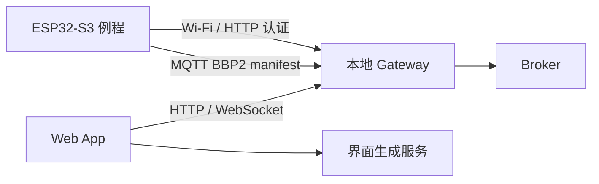
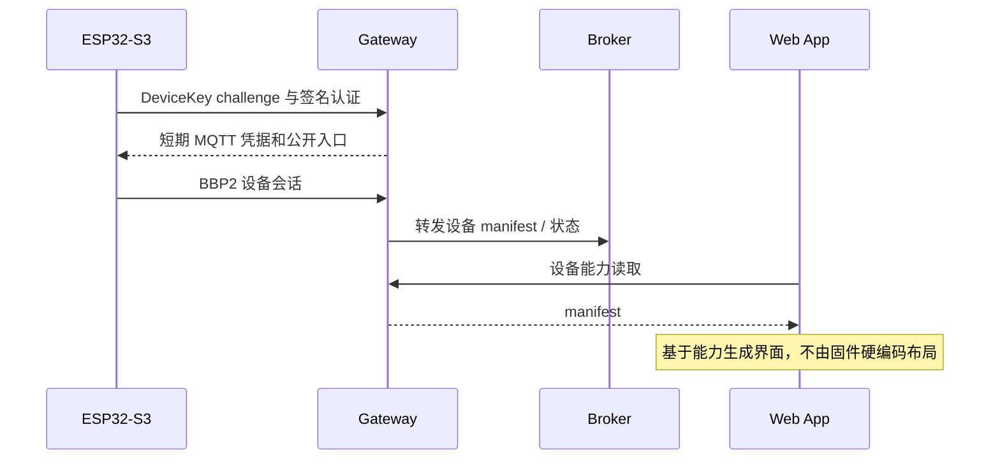

# 设备界面联调执行计划

## Intent：最终目标

使用本仓库为 ESP32-S3 生成并烧录例程，让本地后端的 test 设备上报真实能力 manifest，供 Web App 的界面配置与 AI 生成功能读取。

## Data：可用证据

- 用户指定本仓库、ESP32-S3、目标设备，并提供 Wi-Fi 与 DeviceKey。
- Web App 使用本地 Gateway HTTP 17000，Gateway MQTT 8883 / WebSocket 8884。
- 首次检查未发现 ESP32 USB 串口；待用户确认连接和板型。
- 依据仓库实际 QuickStart 和 API 定义生成例程，不依赖 README 中未随仓库提供的历史文件。

## Edges：边界与限制

- 密码和 DeviceKey 仅放本地忽略文件，不进入文档、日志或提交。
- 不预设未知硬件引脚或连接负载；例程暴露明确的演示状态和真实运行指标，不伪造传感器数据。
- 不更改核心库协议来适配单个设备；不新增测试，不进行浏览器 UI 验证。
- 烧录以实际检测的板型与串口为准；未连接时不声称完成。

## Answer：交付与成功标准

1. 例程、凭据模板及构建方式。
2. ESP32-S3 编译通过。
3. 检测设备并烧录，串口确认入网与会话建立。
4. 后端只读验证设备在线及 manifest 内容；记录 AI 调用尚需用户侧验证的边界。

