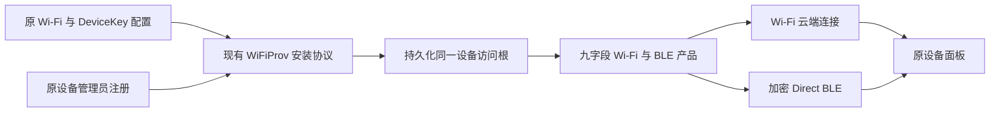
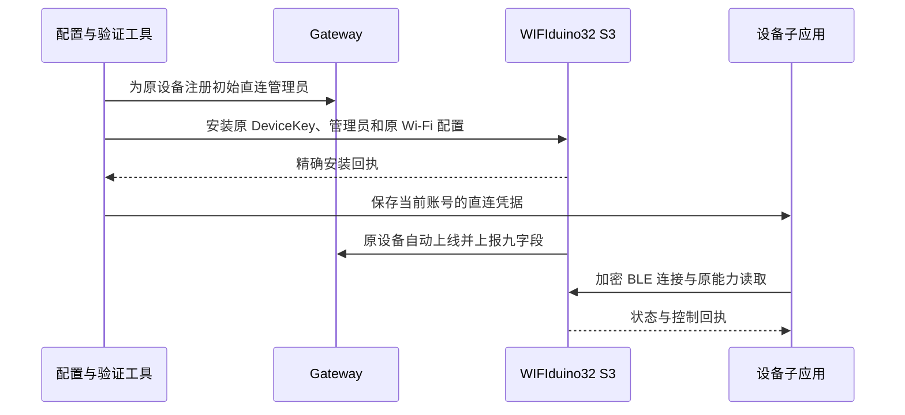

# WIFIduino32 S3 无线与蓝牙共存执行计划

## Intent：最终目标

保留 WIFIduino32 S3 的 Wi-Fi 自动上线、云端连接和原九项功能，并增加 BLE。用户随后明确选择集中到已有 BLE 设备 ee：保留 ee 的绑定，在该条目统一使用 Wi-Fi 与 BLE；原 Wi-Fi 设备记录保留但不再承载硬件连接。

## Data：可用证据

- 原 Esp32S3InterfaceDemo 已恢复，九字段能力与持续状态上报正常；原应用、启动和 NVS 备份已校验。
- 目标板为 `/dev/cu.usbserial-310` 对应的 16 MB WIFIduino32 S3，与此前备份身份一致。
- 库已有 Esp32WifiBleProduct，完成初次配置后同时运行 Wi-Fi 云端和 Direct BLE，共享同一个 Client、设备模型和持久身份。
- 子应用已有普通 Wi-Fi 设备的 Cloud/BLE 连接选择逻辑，但只有本机持有有效 controller 凭据时才尝试 Direct BLE。
- 已有 WiFiProvAdmin.install 可以为同一个 logical device 注册初始管理员、向固件安装原 DeviceKey 与管理员凭据，再保存本机凭据。
- WiFiProvAdmin.reconfigure 会旋转 DeviceKey，不适合此次保留原凭据的目标。

## Edges：边界与限制

- 不再烧录纯 BLE 最小例程，不删除或重建原账号设备，不旋转原 DeviceKey，不清空 NVS。
- 保留九个字段及其类型、权限、LED 与按钮回调、周期遥测和原界面定义。
- 复用库和子应用已有配置、授权、加密与传输协议，不写设备 ID 特判，不直接伪造数据库授权或在线状态。
- 初次配置只建立 BLE 直连所需的持久访问根；原 SSID、密码、DeviceKey 来自现有受保护配置，不打印或写进记录文档。
- 构建前核对固件大小和实际分区。如果超出当前应用分区，先确定保留数据的最小布局调整，不能直接扩大擦除范围。
- 不使用浏览器做 UI 确认，不新增单元测试用例。使用真实设备、现有协议和状态上报验证。

## Answer：实施步骤与成功标准

1. 为原示例增加明确的 Wi-Fi/BLE 共存构建选项，默认 Wi-Fi 构建保持兼容。
2. 编译九字段共存固件，检查实际镜像大小、内存、分区和签名配置。
3. 在已核对的同一块板上写入固件，使用现有 WiFiProv 安装路径交付同一设备的凭据；不进入会旋转 DeviceKey 的重配路径。
4. 验证原 logical device 自动上线、九字段能力一致、状态持续更新。
5. 验证该设备的 Direct BLE 授权、连接、九字段读取和可控操作，并确认 Wi-Fi 同时保持在线。
6. 断开测试连接并重启复核，记录用户继续测试的入口和准确限制。

## 自我复核要求

- 以原设备身份和真实双通道数据为成功标准，不能只证明有蓝牙广播。
- 每个阶段先核实是否保留原行为，避免再次用功能替换满足局部测试。
- 配置、源码、固件、账号状态分别记录；明确尚未验证的层次。

## 执行中的证据与决策边界

- 原示例已增加 wifi-ble 构建选项，九个字段及回调没有改动。普通共存镜像 1,321,808 字节，超出当前 app0；仅为 C++ 和链接启用 LTO 后降至 1,278,720 字节，剩余 32,000 字节，无需改分区。对全部 C 源同时启用 LTO 会与 ESP32 SDK backtrace 的汇编重定位冲突，因此未采用。
- 配套本地测试公钥的共存固件已编译并校验，分区表与原备份完全一致；一次烧录已通过 hash 校验。
- 真实 WiFiProv 握手确认同一 deviceInstance，但访问根已有 accessEpoch=3054540576、没有 DeviceKey。初次安装协调器正确拒绝覆盖已有授权，没有注册新管理员、没有写入新凭据。
- 只读服务端核对发现，该物理设备已有完成认领的独立 BLE 测试设备 ee，与原 Wi-Fi 条目同账号。两条记录不能直接共用或混写一个访问根。
- 先恢复原 Wi-Fi 应用以维持正常使用；是否解除 ee 的测试绑定并将 BLE 安装到原设备条目，需要用户针对这条现存记录确认。不能静默删除用户已经创建的设备记录。

## 用户确认后的最终路径

用户明确取消移除 ee，并选择“集中到 ee：Wi-Fi + BLE，保留九项功能”。因此取消旧 Wi-Fi logical ID 的初始管理员安装方案，改用现成 `devices:enable-cloud` 为 ee 追加云端 DeviceKey，再通过 `configureBlinkerAccess` 的普通 Install 写入现有访问根。该路径保留 ee 的 controller、accessEpoch 和 PresenceKey，不删除任何设备，不清除 NVS，也不旋转原 Wi-Fi 设备的旧 DeviceKey。

九字段共存固件与原 SSID/密码保持一致；后续从 ee 打开九字段设备。旧 Wi-Fi 记录将离线保留，这是用户此次集中选择的预期结果。

## 完成结果

已按用户最终确认集中到 ee：保留既有 BLE 绑定，新增 Wi-Fi 云能力和原九字段共存固件。连续两次启动后的首次 BLE 认证、数据同步及控制回执通过，ee 的 MQTT 上线和状态更新正常。完整结果见同目录《WIFIduino32 S3无线与蓝牙共存执行记录.md》。
