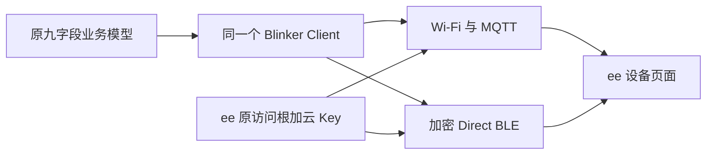
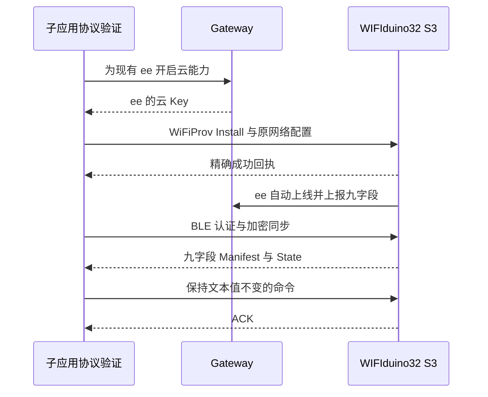

# WIFIduino32 S3 无线与蓝牙共存执行记录

## Intent：最终目标

在 WIFIduino32 S3 上同时保留 Wi-Fi 自动上线和 BLE 直连，使用原九字段功能。用户最终明确选择集中到已有设备 ee：不移除 ee，保留其 BLE 绑定，为它增加云端能力。原 Wi-Fi 设备记录保留，后续从 ee 使用同一块板。

## Data：证据与实施

### 原业务与构建

- 在 Esp32S3InterfaceDemo 增加可选 `wifi-ble` 构建方式，默认 `wifi` 方式保持兼容；九个字段、类型、权限、回调和五秒周期上报共用原代码。
- 保留 demoPower、demoBrightness、demoLabel、buttonPresses、pressButton、wifiRssi、uptimeSeconds、freeHeapBytes、totalHeapBytes。
- 共存模式使用库现有 Esp32WifiBleProduct，将云端和 Direct BLE 接在同一个 Client 和设备模型上，没有建立第二套业务状态。
- 普通优化的共存镜像超出当前 app0。仅对 C++ 编译和链接启用 LTO 后可容纳完整功能；C 编译保留默认设置，避免 ESP32 SDK backtrace 的汇编重定位冲突。
- 最终固件为 1,279,344 字节，当前应用分区为 1,310,720 字节，剩余 31,376 字节；没有改变分区表或减少原字段。
- 最终固件 SHA-256：`995f3d06ead3f1d4509da882e1bf4b3e70fbe1343f1de2974d41b5bd5f67c436`。
- 本地固件使用与测试网关匹配的公钥，公钥仅位于隔离库副本；私钥未进入固件。原正式公钥配置未改动。

### 保留 ee 的访问根

- 真实 WiFiProv GetInfo 证实板卡 instance 与原记录一致，已有 BLE accessEpoch=3054540576，但没有云端 DeviceKey。
- 只读服务端核对确认该访问根属于已完成认领的 ee，与原 Wi-Fi 记录同账号。初次安装协调器拒绝覆盖现有根，未产生第二套管理员。
- 用户取消移除 ee，并明确选择“集中到 ee：Wi-Fi + BLE，保留九项功能”。
- 通过正常鉴权的 `POST /api/v2/devices:enable-cloud` 为 ee 增加云端 DeviceKey，返回的 logicalDeviceId 与 ee 一致；重放请求返回同一 Key。
- 复用 `configureBlinkerAccess` 的普通 Install 操作，经 Security 1 加密的 WiFiProv 通道安装云 Key，精确回执成功。没有运行 Bootstrap、reconfigure、resetAccess 或设备删除。
- 复用原 SSID 和密码完成网络配置。已有 controllerSecret、controllerId、accessEpoch 和 PresenceKey 均保留。
- 当前客户端原有的 ee 安全凭据继续用于 BLE；没有把原 Wi-Fi 条目与 ee 共用或混写一个访问根。
- 被 Git 忽略的示例 secrets.h 已改用 ee 的云 Key，网络配置不变；旧配置保存在权限受限的本地备份中。

### 桌面 BLE 发现修复

- 配网和 Direct 使用同一蓝牙地址但不同 GATT 服务。实机发现 macOS 缓存了旧配网服务，重复发现和重启设备、子应用都未立即更新；用户已按提示关闭再开启 Mac 蓝牙。
- 固件仅在 WiFiProv 完成并切换到 Direct、GATT 数据库实际变化时标记通知；收到标准 Service Changed 特征的 indication 订阅后发送，并在空中 ACK 后清除待通知状态。普通重启不重复让缓存失效。未改变蓝牙地址，也未绕过 Direct 服务验证。此通知需要客户端订阅，见 [Espressif 维护者说明](https://github.com/espressif/esp-nimble/issues/72)。
- macOS 崩溃日志进一步确认，失效的 characteristics 列表包含 CBService，旧 noble 调用其 properties 导致原生进程退出。补丁检查 CBCharacteristic 类型和属性能力，并在发现失败时不读取失效列表。
- noble 重复收到同 UUID 的 service discovery 时会替换 Service 对象，导致旧对象的 characteristicsDiscover 等待者失联。补丁仅在仍有该回调等待时保留原对象，保持正常刷新行为。
- 没有保留未经调用方协调的自动 service discovery；发现仍走子应用现有的串行流程，避免并发发现互相覆盖。
- 原生模块已重建，设备子应用完整打包通过，便携包中的 macOS binding 与当前构建字节一致。临时诊断事件与串口调试输出已移除。

### 已获得的真实双通道证据

- ee 的 Broker 记录为 active、mqtt_online=1，Manifest 包含九个字段，状态持续更新。
- BLE Direct v3 广播可发现，标准收发特征正确；实际完成 controller 身份认证和加密会话。
- BLE 同步结果包含全部九个字段，stateFresh=true；能够读取实际 Wi-Fi 信号和运行时长。
- 通过 BLE 发送保持 demoLabel 当前值不变的命令，收到真实 ACK；随后状态版本继续增加。
- 使用已有 PresenceKey，同步结果为 deviceConfirmed=true；没有替换原 BLE 授权。

## Edges：边界与限制

- 原名 WIFIduino32 S3 的旧 Wi-Fi 记录保留但不再承载当前硬件连接；用户已明确选择集中到 ee。没有删除两条记录中的任何一条。
- 用户需要刷新设备目录并重新打开 ee，使当前 UI 获得 `cloudEnabled=true`、`gatewayRouted=false`。子应用已有 Cloud/BLE 选择与回退逻辑，不需要把 deviceType 改成另一种类型。
- 控制验证使用不改变文本值的命令，没有额外触发 LED 闪烁或修改业务值。九项字段和原回调均保留，但不把一次 ACK 宣称为所有执行器动作均逐项实测。
- 未调用浏览器验证 UI，没有新增单元测试文件。验证依据为真实固件、BLE、服务接口和 Broker 状态。
- 此前备份、配置、签名材料和诊断程序位于被 Git 忽略的 `.build/`；含有设备私密数据的产物不提交或上传。

## Answer：交付

交付原示例的 Wi-Fi/BLE 共存构建选项、GATT 服务变化通知、桌面 noble 的失效对象与回调竞争修复，以及集中到 ee 的已安装共存固件。重启后首次连接的最终复核结果记录在本文件末尾。

## 自我复核

- 最终方案按用户确认集中到 ee，不能继续描述为旧 Wi-Fi logical ID 也在同时上线。
- 保留现有访问根，使用正式启云和配置协议，没有直接修改数据库授权或伪造在线状态。
- 分区容量以真实镜像字节数校验，不以构建工具打印成功替代容量检查。
- 重启首连暴露的问题继续修复并复核，不以一次成功掩盖不稳定性；UI 未实测的范围明确保留。

## 最终复核结果

- 清理诊断后的最终镜像已写入并通过 hash 校验，分区表保持不变。
- 最终固件连续两次启动后，首次 BLE 连接均完成认证、九字段 Manifest/State 同步、Presence 确认和保持原文本值的控制 ACK。
- 第一轮 BLE 状态版本从 10 增至 12，读取 Wi-Fi RSSI=-57 dBm、运行时长 55 秒；第二轮独立重启后从 2 增至 4，RSSI=-53 dBm、运行时长 15 秒。
- 第二轮结束后继续只读核对，ee 的 MQTT 在线标记和九字段状态上报保持正常。所有诊断 BLE 连接已关闭。
- 子应用最终便携包构建通过，AST 检查确认包含等待回调保留修复，原生 binding 与当前构建完全一致。runtime 临时诊断代码已全部移除。
- 完成范围：真实硬件的 Wi-Fi 自动上线与 BLE 加密读写已验证；用户刷新设备目录后，从 ee 继续测试。
