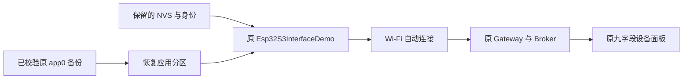
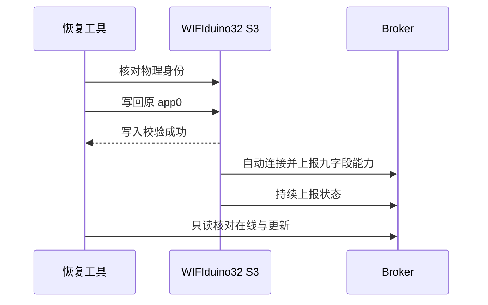

# WIFIduino32 S3 自动上线恢复记录

> 此为前期阶段记录。后续已按用户确认集中到 ee，使用原九字段 Wi-Fi/BLE 共存固件；最新结果见 [共存执行记录](./WIFIduino32%20S3无线与蓝牙共存执行记录.md)。

## Intent：最终目标

恢复用户原有 WIFIduino32 S3 的 Wi-Fi 自动上线和九字段界面数据。用户要求测试 BLE，但此前采用纯 BLE 例程替换现有 Wi-Fi 固件，破坏了原有使用流程，本次先撤回该固件替换。

## Data：可用证据

- 用户反馈原设备停在“正在连接并同步”，Wi-Fi 信号和运行时长没有数据。
- 纯 BleQuickStart 不启用原例程的 Wi-Fi 云端连接，也不保留九字段能力，是本次功能退化的直接原因。
- 用户重新连接 USB 后，目标串口为 `/dev/cu.usbserial-310`。esptool 读取的板卡 MAC 与之前备份匹配，Flash 为 16 MB。
- 原备份 SHA-256 校验通过；`original-app0.bin` 与备份中的完整 app0 字节一致，长度为 1,310,720 字节。
- 第一次恢复写入被会话中断，日志停在 77.1%，不能视为成功。重新完整写入同一应用分区后，esptool 报告 Hash of data verified 并复位。
- 仅恢复 `0x10000–0x150000` 应用分区；未恢复或擦除 NVS、启动区、分区表、其他应用和数据分区。
- 串口诊断确认 `state=active`、`network=1`、`cloud=1`、`lastOperationError=0`、`productError=0`、`operationFailures=0`。
- 原 logical device 在 Broker shard 2 恢复 `mqtt_online=1`，Manifest 的九个字段完整，状态开始重新更新。
- 关闭串口后，在同一个设备会话内间隔约 55 秒再次采样，状态 revision 从 7 增至 18，mqtt_online 持续为 1，确认设备独立持续上报。

## Edges：边界与限制

- 本次恢复原 Esp32S3InterfaceDemo；当前固件仍是原有 Wi-Fi 产品，不宣称同时启用了 BLE。
- 原设备身份、凭据、界面和账号记录保留；没有删除 BLE 测试配置或其他设备记录。
- 本地 Gateway 的 BLE 测试 signer 配置仍保留，它不替换原 Wi-Fi DeviceKey，也不妨碍原设备上线。
- 未通过浏览器验证界面；硬件恢复以烧录校验、串口诊断、后端在线状态和连续数据更新为证据。
- 未改动正式库源代码，没有新增测试用例。

## Answer：恢复与验证

原应用固件已恢复，自动 Wi-Fi 入网、云端连接和九字段状态上报恢复正常。后续 BLE 测试应以保留现有 Wi-Fi 上线和原能力为边界，不能再次直接替换为纯 BLE 最小例程。

备份和恢复日志位于 Git 忽略的 `.build/wifiduino-s3-ble-20261016/`。该目录包含设备私密配置，不提交或上传。

## 自我复核

此前把“测试 BLE”直接落实为纯 BLE 固件替换，虽提前说明 Wi-Fi 会离线，仍未对齐用户保留原设备正常使用的需求。问题在于测试方案选择，不应通过要求用户接受既有功能丢失来完成测试。本次使用已核对的原应用备份回退，不以重新建账号设备、修改 UI 在线标记或清除身份绕过问题。
