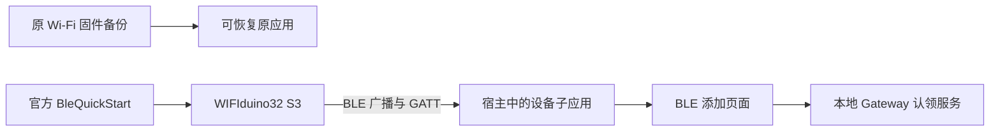
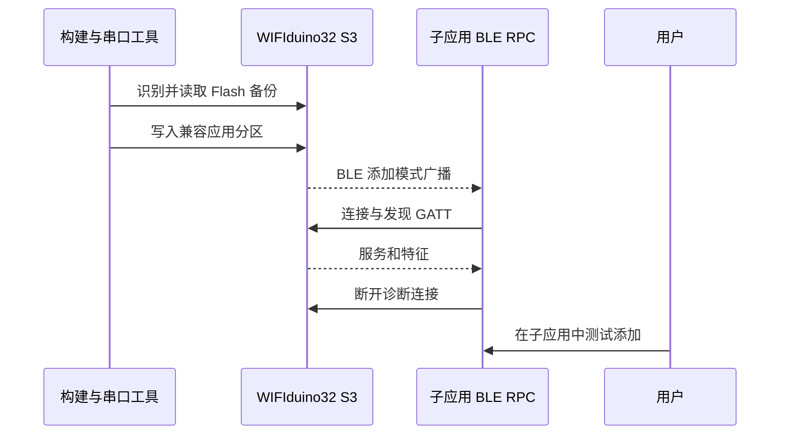

# WIFIduino32 S3 蓝牙测试执行计划

> 此为前期阶段记录。后续已按用户确认集中到 ee，使用原九字段 Wi-Fi/BLE 共存固件；最新结果见 [共存执行记录](./WIFIduino32%20S3无线与蓝牙共存执行记录.md)。

## Intent：最终目标

在用户指定的 WIFIduino32 S3 上实际测试设备管理子应用的 BLE 添加链路。临时使用官方 BleQuickStart，让目标硬件提供可识别的 BLE 广播与 GATT 服务，保留原 Wi-Fi 固件的恢复路径。

## Data：可用证据

- 用户明确要求测试 BLE。
- 正确设备是 WIFIduino32 S3；另一台名为 Esp32 S3 的 8 MB 设备不属于本次目标。
- 本次 esptool 在 `/dev/cu.usbserial-310` 识别为 ESP32-S3 revision 0.2、16 MB Flash、8 MB 内置 PSRAM。
- 最近确认的原固件为 Esp32S3InterfaceDemo，使用 Wi-Fi 接入，有 9 个能力字段。
- BleQuickStart 使用 BlinkerBLE.h，提供 power、buttonPresses、button 三个官方示例能力，用于验证 BLE 接入。
- 子应用当前使用本地 Gateway；宿主原生 BLE 扫描曾经通过，但此前未确认目标板的 BLE 广播。

## Edges：边界与限制

- BLE 测试固件运行期间，原来的 Wi-Fi 面板会离线；不删除原账号设备记录。
- 先备份将被替换的应用分区及启动、身份数据，核对实际分区，再只更新兼容的应用分区；不整片擦除，不自动清除访问授权。
- 备份和构建产物放在 Git 忽略、权限受限的 `.build/wifiduino-s3-ble-20261016/`，不输出其中凭据。
- 复用官方例程，只在隔离工作副本加入串口诊断入口，不修改产品协议或放宽广告识别条件。
- 不调用浏览器做 UI 确认；通过真实串口、宿主 BLE RPC 和服务发现验证。为用户保留子应用中的首次添加操作。
- 发现持久授权或签名配置冲突时，先定位具体状态，不以擦除 NVS 或忽略签名绕过。

## Answer：步骤与成功标准

1. 识别目标板并备份 0x0–0x150000 的启动、NVS 与原 app0，记录备份大小和 SHA-256；其他分区不写入。
2. 核对原分区与 BLE 固件大小，使用已安装的 ESP32 工具链构建官方例程。
3. 比较固件信任公钥与本地 Gateway 的 BLE 签名配置，确认添加协议的前提。
4. 在备份成功后写入应用分区，验证写入校验与启动状态。
5. 通过宿主子应用扫描，确认目标广播、Provisioning 模式、协议版本和所需 GATT 特征。
6. 断开诊断连接，使目标设备保持可供用户添加的状态；报告已验证与未验证范围。

## 自我复核

- 以此次物理识别结果为准，不再混用两块 S3 的参数和历史固件。
- 扫描、GATT 连接与账号认领是不同验证层次；不能将前两项成功写成完整添加成功。
- 原 Wi-Fi 例程和原账号记录保留；测试固件的三个能力不冒充原九个能力。

## 准备阶段补充证据

- 921600 和 460800 波特率连续大块读取均出现串口包损坏，未执行任何 Flash 写入。改为 115200 波特率备份启动、NVS 和完整 app0，不重复读取此次不会写入的其余 Flash。
- 官方 BLE 例程编译成功，程序 1,173,555 字节，静态内存 56,932 字节，应用分区上限 1,310,720 字节。
- 当前 17000 端口对应本地 Gateway 容器，尚未配置 BLE enrollment 签名密钥；需要按 ESP32 实际采用的 P-256 信任公钥补齐本地测试签名配置。

- 原始启动、NVS 与 app0 备份已完成，大小 1,376,256 字节，SHA-256 为 `14416f582fa1bc6e899df022a5f2f6d6363c812fd380f7294a9c55955f9aa881`。
- 从真实备份解码的 app0 起点为 0x10000、大小 0x140000；备份中的应用与最近 Esp32S3InterfaceDemo.bin 逐字节一致。BLE 产物大小 1,173,696 字节，适配当前分区。

## 执行状态

准备、备份、配套本地签名配置、编译烧录及真实 BLE 发现/GATT 验证均已完成。设备保留在 Provisioning，供用户首次添加；执行细节见同目录《WIFIduino32 S3蓝牙测试执行记录.md》。
