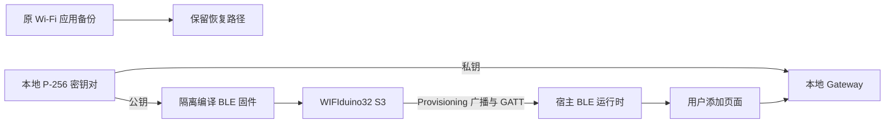
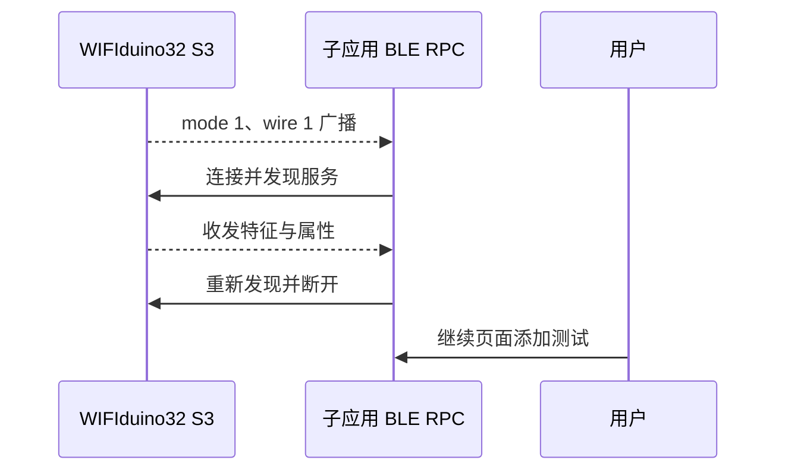

# WIFIduino32 S3 蓝牙测试执行记录

> 此为前期阶段记录。后续已按用户确认集中到 ee，使用原九字段 Wi-Fi/BLE 共存固件；最新结果见 [共存执行记录](./WIFIduino32%20S3无线与蓝牙共存执行记录.md)。

## Intent：最终目标

为用户在设备管理子应用中测试 BLE 添加准备真实 WIFIduino32 S3，并分别确认固件、蓝牙发现、GATT 和本地认领签名服务的状态。

## Data：可用证据与执行结果

### 目标与备份

- 本次串口为 `/dev/cu.usbserial-310`，芯片工具识别 ESP32-S3 revision 0.2、16 MB Flash、8 MB 内置 PSRAM；没有操作另一台 8 MB 的 Esp32 S3。
- 读取 `0x0–0x150000` 的启动数据、NVS、OTA 数据和完整 app0，备份大小 1,376,256 字节。
- 备份 SHA-256：`14416f582fa1bc6e899df022a5f2f6d6363c812fd380f7294a9c55955f9aa881`。
- 从真实备份解码的 app0 偏移为 `0x10000`、大小为 `0x140000`；原应用与最近的 Esp32S3InterfaceDemo.bin 逐字节一致。
- 921600 和 460800 波特率的大块读取出现串口包损坏；改为 115200 后完整读取成功。失败阶段未写入 Flash。

### 本地签名配置

- 当前 ESP32 BLE 平台使用 P-256/keyId 1；PortableServerKeys 的 Ed25519 不适用于这块板。
- 实际运行的本地 Gateway 原先没有配置 BLE enrollment signer。生成本地测试专用 P-256 密钥，将私钥保存在服务仓库已忽略的 `data/keys/device-manager-ble-test-p256.pem`，权限 600。
- 在同样被 Git 忽略的 `services/gateway/.env` 设置私钥文件容器路径及 keyId。现有 Compose 已将 `data/keys` 只读挂载为 `/app/keys`。
- 核对 Compose 解析结果与运行容器配置，环境差异只有新增的两个 BLE 配置项；仅重新创建 gateway 容器，健康检查通过。
- 对应公钥仅写入隔离编译库副本的 Esp32ServerKeys.h。原库源码未修改，未把私钥写入固件或文档。
- 容器中私钥导出的公钥与最终固件内嵌公钥一致，SHA-256 为 `04d58eddc2ae358df0cb13e04abfefc4e5fccd70bbe60d9546318089ec5178cd`。

### 编译、烧录与设备状态

- 复用官方 BleQuickStart，在隔离工作副本加入串口 `d` 诊断入口。例程保留官方的 power、buttonPresses、button 三个能力。
- 使用 ESP32 Arduino 3.3.1、ESP32 Arduino libs 5.5.0、FlashSize=16M、CDCOnBoot=default、PSRAM=disabled；关闭远程构建缓存和上传。
- 最终固件大小 1,173,696 字节，小于当前 app0 的 1,310,720 字节。
- 固件 SHA-256：`06237d45c5cd9cf91958de4086650b738e9f47cc589a6663d628e1dbad5a588c`。
- 仅向 `0x10000` 写入应用，esptool 报告 Hash of data verified；未写入启动区、分区表或 NVS，未执行整片擦除。
- 串口诊断确认 `state=provisioning`、`started=1`、`lastOperationError=0`、`productError=0`、`operationFailures=0`。

### 实际蓝牙链路

- 使用宿主正在运行的 device-manager Node BLE RPC，当前账号已登录 Development 区域，本地 Gateway 为 `http://127.0.0.1:17000`。
- 适配器状态为 poweredOn；按 Blinker 服务 UUID 扫描后出现新的 Blinker 广播，13 字节 serviceData、mode=1、wireVersion=1，符合添加模式。
- 目标 Provisioning locator 为 `b15e02c4aad416ac`，与附近另外两个 Direct 模式广播分开处理。
- 真实连接成功；服务 `5f6d0001-3f5b-4e4f-9f4d-626c696e6b32` 存在。
- 接收特征 `5f6d0002-3f5b-4e4f-9f4d-626c696e6b32` 支持 write 和 writeWithoutResponse；发送特征 `5f6d0003-3f5b-4e4f-9f4d-626c696e6b32` 支持 read、notify、indicate。
- 真实 GATT 重新发现成功，随后主动断开诊断连接。未发送认领记录、未调用 issue/commit、未创建新 BLE 设备。
- 只读核对原 Wi-Fi 设备最近 session 对应的 instance：active Direct root、active BLE intent、未过期 pending intent 和既有 BLE enrollment 历史均为 0，没有首次 BLE 认领冲突。Provisioning locator 是随机值，不以它伪称已完成协议身份握手。

## Edges：边界与限制

- 当前运行纯 BLE 官方测试例程，原 Wi-Fi 设备会离线。原九字段界面和云端设备记录没有删除，原固件已备份。
- power 是软件状态，button 动作用于增加计数；此官方测试例程不驱动板载 LED。
- 尚未完成用户界面中的账号认领和控制；扫描与 GATT 成功不能代替完整添加成功。
- 原持久化 deviceInstanceId 保留；纯 Wi-Fi 绑定本身不会阻止首次 BLE enrollment。用户完成添加后会创建独立 BLE logical device，原 Wi-Fi 条目仍保留。
- 恢复原应用固件不等于撤销服务器端 BLE enrollment。若以后需要清理测试绑定，应通过正式设备管理流程处理，不能仅恢复旧 NVS 后重新认领。
- 系统启动日志报告原 coredump 区域格式异常，未阻止固件进入 Provisioning 和完成蓝牙连接；没有为处理该日志擦除额外分区。
- 未使用浏览器验证 UI，没有新增单元测试用例。

## Answer：交付与成功标准

设备已烧录可用于本地子应用添加流程的 BLE 测试固件，真实发现、连接、GATT 重新发现和断开已通过，本地签名配置与固件公钥匹配。用户可回到“配置 BLE 设备”页面重新开始添加。

本地备份、编译副本、固件和日志保存在 `.build/wifiduino-s3-ble-20261016/`；该目录被 Git 忽略且权限受限，包含原设备私密数据，不应提交或上传。

## 自我复核

- 改正了此前两台 S3 的历史记录混淆，以物理识别和原应用字节比对确认目标。
- 签名配置缺失通过真实容器状态确认；新配置只影响本地 BLE 认领签名，没有跳过协议验证或使用伪造设备信息。
- 保留官方例程和协议，仅在隔离副本注入与网关配套的公钥；没有修改正式库源码。
- 用户仍需完成首次添加；本记录不将测试准备成功扩大为已认领和已控制成功。
