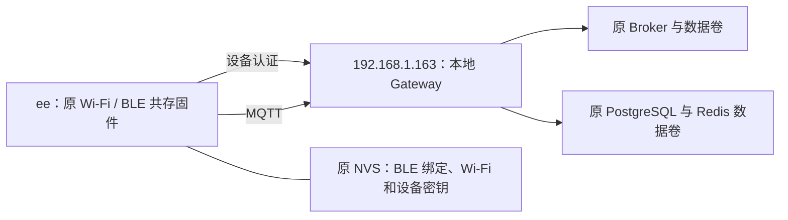
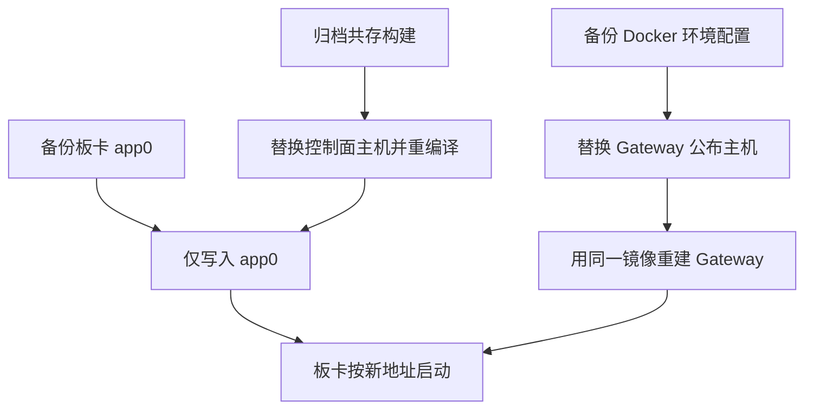

# WIFIduino32 S3 本地网关地址更新计划

## IDEA

| 项 | 内容 |
| --- | --- |
| Intent | 将 `ee` 板卡固件的网关地址和本地 Docker Gateway 公布的地址改为 `192.168.1.163`。 |
| Data | 当前 Mac 局域网地址为 `192.168.1.163`。已安装的 Wi-Fi/BLE 共存固件编译参数以及 Docker Gateway 原配置均使用 `192.168.1.108`。串口为 `/dev/cu.usbserial-310`。 |
| Edges | 复用原共存构建，仅调整控制面主机。写入前保存应用分区，只写原 app0，保留 NVS、OTA 数据和分区表。沿用原 Gateway 镜像，只重建网关容器。 |
| Answer | 交付更新后的固件写入和网关配置。按用户最后指令取消 App 验证和写入后的状态复测。 |

## 架构图

## 数据流图

