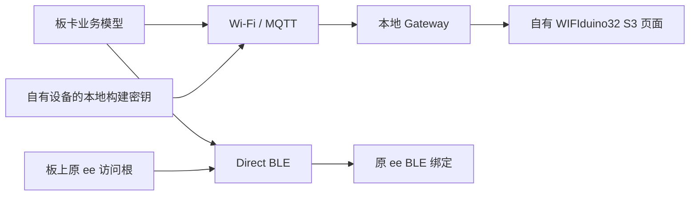
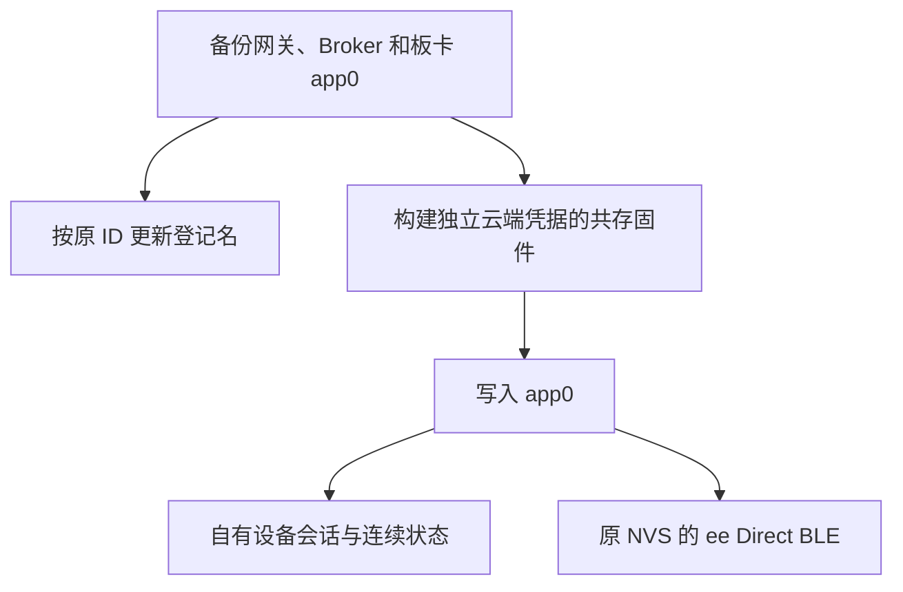

# WIFIduino32 S3 自有云端切换计划

## IDEA

| 项 | 内容 |
| --- | --- |
| Intent | 板卡将云端状态上报到当前 Development 账号自有的 `WIFIduino32 S3`，并把原登记名 `test` 改为 `WIFIduino32 S3`。 |
| Data | 两条设备记录的历史会话具有同一个板卡实例。原共存构建中的云端会话栈接收独立的 DeviceKey source，Direct BLE 读取板上的 DeviceAccessStore。 |
| Edges | 复用 10 月 16 日共存固件及现有本地地址。改动只在隔离构建，云端凭据保存在私有构建文件。只写 app0，保留 `ee` 的 NVS、BLE 管理员、设备身份及测试数据。 |
| Answer | 两处登记名一致，原设备 ID 和页面布局保持。Broker 确认自有设备收到新会话和连续状态上报。记录 BLE 验证范围及原固件备份。 |

## 架构图

## 数据流图

