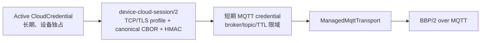

# Device V2 Cloud Session Contract

> 合同名：`device-cloud-session/2`  
> 设备参考实现：`CloudSessionContract` + `HttpCloudSessionProvider`  
> 状态：wire freeze candidate；App/服务器生产实现和真机门禁完成前不得宣称发布就绪。
> 设备实现已统一使用长期 `CloudCredential`，不是 ManualDeviceKey/Ticket。Ownership/Cloud enrollment
> common wire 已冻结；WiFi outer 修订为 ManualDeviceKey，BLE 使用 EnrollmentTicket/LocalSetup；本合同只负责把
> 已 Active 的长期凭据换成短期 SessionCredential，不重新解释任何首次认领语义。

## 1. 这个合同解决什么问题

该合同只负责把已经持久化为 `Active` 的 CloudCredential 换成短期、限域的 MQTT SessionCredential。它不描述 App 页面，不承载 Manifest/State/Command，也不是阿里云物模型。设备正常重启、长期断网或
SessionCredential 过期都走本合同，不重新提交 ManualDeviceKey/Ticket，也不要求 App 再配网。



长期 secret 只存在设备的 `CloudCredentialStore`，运行消费者只依赖只读
`ICloudCredentialSource`。App 不接收
CloudCredential 或 MQTT password；服务器按用户 session、ownership 和 ACL 独立授权 App。

## 2. HTTP 外层

| 项目 | 冻结值 |
|---|---|
| Method | `POST` |
| Path | `/api/v2/device-sessions` |
| Transport | `PlainTcp` 或 `TLS`；默认 `PlainTcp`，由设备发布 profile 静态选择，禁止运行时静默降级 |
| Content-Type | `application/cbor` |
| Accept | `application/cbor` |
| Contract header | `X-Blinker-Contract: device-cloud-session/2` |
| Success | HTTP 200 + `CloudSessionResponse` |
| Error | 本文冻结的 HTTP status + `CloudSessionErrorBody` |
| Redirect | 禁止；3xx fail closed |
| JSON fallback | 禁止在同一次 v2 会话中 fallback |

请求、响应和错误体都是 definite-length、最短整数编码、整数 key 严格升序的 canonical CBOR。未知、重复、乱序 key、尾随数据、非法 UTF-8 和越界长度全部拒绝。

## 3. 请求

`CloudSessionRequest` 是固定 9 项 map：

| Key | 类型 | 约束 |
|---:|---|---|
| 0 | uint | contract version，固定 `2` |
| 1 | bstr | 16 B `requestId`，CSPRNG 生成且不得全零 |
| 2 | tstr | `logicalDeviceId`，来自 Active credential |
| 3 | uint32 | `credentialVersion` |
| 4 | uint32 | ownership `generation` |
| 5 | uint | BBP protocol version，固定 `2` |
| 6 | tstr | firmware version，1～64 B UTF-8 |
| 7 | uint | proof algorithm，固定 `1 = HMAC-SHA256` |
| 8 | bstr | 32 B proof |

proof 是 Active CloudCredential secret 上的 HMAC-SHA256。签名 transcript 不是 request map，而是以下固定 8 项 CBOR array：

```text
[
  "blinker.device-cloud-session.request.v2",
  requestId,
  logicalDeviceId,
  credentialVersion,
  generation,
  protocolVersion,
  firmwareVersion,
  proofAlgorithm
]
```

Gateway 验证该 HMAC 必须持有等价 verification key；普通 password hash/peppered lookup hash 不能验证
challenge HMAC。对称 key 必须由 KMS/HSM 或应用层 envelope 保护，并在受控内存中使用。若未来要求服务器
只保存公开材料，应新增签名型 CloudCredential suite，不能修改 HMAC suite 的安全描述。

`physicalDeviceId` 只属于 enrollment、factory registry 与 ownership reset 域。服务器在激活
CloudCredential 时已经冻结 `logicalDeviceId/credentialVersion/generation -> physical asset`
关系；云登录按 Active credential 查回该关系，不要求设备每次加载 factory identity，也不把 MAC
降格成永久身份。`device-cloud-session/1` 尚未发布，本次直接废弃，不建立双 decoder。

当前 32 位 ABI 中设备只在构造 HMAC 时把 108 B `CloudCredential` 载入栈（跨 ABI 以
`sizeof` 和 ≤112 B 门禁为准，不把内存布局当 wire）；proof 完成后、
HTTP 开始前必须清零 secret、临时 proof 和请求构造中的敏感临时量。服务器禁止记录 raw body 或 proof。

## 4. 成功响应

`CloudSessionResponse` 是固定 14 项 map：

| Key | 类型 | 约束 |
|---:|---|---|
| 0 | uint | contract version，固定 `2` |
| 1 | bstr | 必须常量时间匹配请求的 16 B `requestId` |
| 2 | uint | broker，当前仅 `1 = Blinker` |
| 3 | tstr | MQTT host，1～96 B ASCII；当前不在此字段表达端口或 IPv6 literal |
| 4 | uint16 | MQTT port，非零 |
| 5 | uint | security：`0 = PlainTcp`，`1 = TLS`；必须与设备固件的 MQTT profile 一致 |
| 6 | tstr | clientId，1～64 B 可见 ASCII |
| 7 | tstr | username，1～64 B 可见 ASCII |
| 8 | tstr | password/token，1～96 B 可见 ASCII |
| 9 | tstr | publish topic，1～96 B ASCII |
| 10 | tstr | subscribe topic，1～96 B ASCII |
| 11 | bstr | 16 B server sessionId |
| 12 | uint32 | `expiresInSeconds`，60～604800 |
| 13 | uint32 | `refreshAfterSeconds`，30～`expiresInSeconds - 1` |

topic 禁止 `+`、`#`，publish 与 subscribe 不得相同。服务器必须在 broker ACL 上把 credential 限制到响应中的 exact topics 和必要操作，不能只依赖设备自律。

两个 TTL 都是设备收到本次响应后，以 monotonic clock 计时的剩余时间。设备不需要可信墙钟。服务器对同一 request 的幂等重放必须返回同一 `sessionId`、broker、credential 和 topics，但剩余 TTL 可以且应递减，不能把首次响应中的相对 TTL 原样永久重放。

如果旧 request 已无法继续给出至少 30 秒 refresh 窗口，服务器返回 `RequestExpired/NewRequest`；只有收到这个明确响应后，设备才允许生成新 requestId。网络超时、掉线和 5xx 不足以证明服务器未处理原请求，设备必须继续使用原 requestId。

## 5. 幂等、重放和刷新

服务器以 `(logicalDeviceId, credentialVersion, generation, requestId)` 建立幂等记录，并保存 canonical request digest：

1. 首次合法请求原子创建一个短期 MQTT session。
2. 同一 tuple、同一 digest 返回同一 session/credential；只更新剩余 TTL 字段。
3. 同一 tuple、不同 digest 返回 HTTP 409 `RequestConflict/Never`。
4. request 的 refresh/replay 窗口结束后返回 HTTP 409 `RequestExpired/NewRequest`，不得把它映射成重新 enrollment。
5. 新的正常 refresh 使用新 requestId，并产生新 MQTT credential generation；成功后设备停止旧 MQTT、应用新 credential 再连接。
6. refresh 失败但旧 credential 未过期时可以继续使用旧 MQTT；一旦本地 TTL 到期，provider 清零 arena 并 fail closed。
7. credential revocation、device revocation 和 generation/version 变更必须同时终止 broker session 与 control-plane session。

HMAC 只证明请求由持有 CloudCredential secret 的设备生成，不提供链路保密、服务器认证或响应完整性。`PlainTcp` 是受限设备的默认兼容档，会向同链路攻击者暴露 cloud-session 响应中的短期 MQTT credential 与后续业务数据，也允许响应被篡改；它不得被标记为 secure profile。需要这些安全属性的产品必须在发布配置中选择 TLS 并提供 CA。无论选择哪一档，Gateway、反向代理、APM、错误采样和消息队列都不得记录或转存 raw request/response；服务端幂等表也只保存必要 digest、session metadata 和受保护的 credential material。

## 6. 错误合同

错误体是 3 项或 4 项 map：`{0: version, 1: error, 2: retryClass, 3?: retryAfterSeconds}`。key 3 只允许且必须用于 `Backoff`，值必须大于零。

| HTTP | Error | 数值 | Retry class |
|---:|---|---:|---|
| 400 | Malformed | 2000 | Never |
| 400 | UnsupportedVersion | 2001 | Never |
| 400 | UnsupportedAlgorithm | 2002 | Never |
| 401 | AuthenticationRequired | 2003 | Reenroll |
| 401 | CredentialNotFound | 2100 | Reenroll |
| 403 | CredentialRevoked | 2101 | Reenroll |
| 409 | CredentialVersionConflict | 2102 | Never |
| 401 | ProofInvalid | 2103 | Reenroll |
| 409 | RequestConflict | 2104 | Never |
| 403 | DeviceRevoked | 2105 | Reenroll |
| 409 | RequestExpired | 2106 | NewRequest |
| 429 | RateLimited | 2500 | Backoff + retryAfter |
| 503 | TemporarilyUnavailable | 2501 | SameRequest，或 Backoff + retryAfter |

设备会同时验证 CBOR error 语义和 HTTP status；两者不匹配属于 `ProtocolError`，不能按其中任意一个猜测重试。
当前 wire 中的 `Reenroll` 只表示“停止自动登录并进入显式 credential recovery/user action”，不表示重用
旧 EnrollmentTicket 或静默创建新 logical device。正式重命名可在 wire 重新冻结时改为
`CredentialRecoveryRequired`。

## 7. 设备实现与资源

核心边界是 `ISessionProvider`：`ManagedMqttTransport` 不知道 CloudCredential、HTTP 或 CBOR，只消费有 generation 的 `SessionCredentials`。Device V2 只保留 `HttpCloudSessionProvider`：Active credential + canonical CBOR/HMAC。`HttpControlPlane`、旧 JSON/authKey codec 已删除；旧设备兼容不进入 V2 固件。

当前实验实现要求应用/composition 提供互不重叠的 caller-owned buffer：

| 资源 | 最小值 |
|---|---:|
| request workspace | 256 B |
| response workspace | 640 B |
| short-term credential arena | 518 B |
| 合计 | 1414 B |

`HttpCloudSessionProvider` 的 32 位静态门槛为 320 B；v2 已删除 factory identity 引用，并用
最大 64 B logical/firmware 与最大 uint32 的 host 门禁证明 256 B request workspace 足够。旧 v1 的
256 B/448 B 对象实测不再作为 v2 精确值引用，新的精确尺寸留给下一次 32 位 ABI probe。provider
不持有第二份 CloudCredential secret；credential arena 只保留短期 MQTT 字符串。

`HttpCloudSessionConfig` 分别声明 `httpSecurity` 与预期的 `mqttSecurity`，两者默认都是 `PlainTcp`，默认 HTTP port 为 80。服务器按设备/产品注册的发布 profile 生成一致的 response；设备收到不一致的 MQTT security 会返回 `ProtocolError`，不会尝试另一种 Client。这里的 HTTP profile只适用于日常 cloud-session，不会放宽 bootstrap：ManualDeviceKey 使用 exact-body HMAC proof，Ticket 走安全 App relay，CloudCredential 注册使用独立端到端保护。网络 gate 为 false 时不得启动 DNS/TCP 或 TLS；断网会取消当前 HTTP transaction、清零 request/response buffer，但保留 requestId 供恢复后的 exact semantic retry。所有网络工作由 `poll()` 驱动。

## 8. App 与服务器实施要求

App：

1. 不实现设备 HMAC，不接触 CloudCredential/MQTT secret。
2. 绑定完成只由服务器 ownership/Active 状态确认；BLE ACK、Direct 广播或设备开始请求 session 都不是在线证明。
3. UI 分离“已绑定、设备云 session 建立中、MQTT 在线、短暂刷新、credential revoked”。

服务器：

1. 在 Gateway 实现本合同的严格 decoder、proof 验证、幂等表和 session issuer；按 Active
   credential 查回 physical asset 绑定，不再从 cloud request 接收 `physicalDeviceId`。
2. 在 broker/auth 层实现 sessionId、TTL、topic ACL、撤销与单设备并发策略。
3. MQTT CONNECT 只产生 `transportConnected`。完成 BBP/2 HELLO、当前 Manifest 校验/接受和所需鉴权后才
   产生 `protocolReady`；只有协商 EndpointIds 时才要求 ID gate。State snapshot 是否完整是独立的
   `stateFresh`，HTTP 200、CONNECT 或 keyed baseline 都不能伪造其他状态。
4. 把本仓库 enrollment fixture 中的六项 `expected.cloud_session_*`（含 Plain/TLS response）纳入 App/服务器 CI，并对生产 parser 做独立 fuzz。
5. 在产品/设备 registry 固定 control/MQTT transport profile；session response 的 key 5 必须与固件一致。Plain 与 TLS 使用独立发布配置和指标，不能在连接失败后自动互相回退。

## 9. 发布阻断项

以下项目完成前，本合同只能作为设备端 freeze candidate：

- App/服务器生产 codec 与 shared golden CI；
- Gateway 幂等、proof、revocation、错误/status 一致性测试；
- broker credential TTL/topic ACL/撤销 E2E；
- ESP32、UNO R4 真机断网、response-loss、refresh、过期与 24 h soak；
- `ProductOrchestrator` 按新模型完成 `Ownership Active -> CloudCredential Active -> cloud session -> managed MQTT`，并证明 Active 后重启完全不依赖 ManualDeviceKey/Ticket；当前旧 orchestrator 仅为实验探针。
